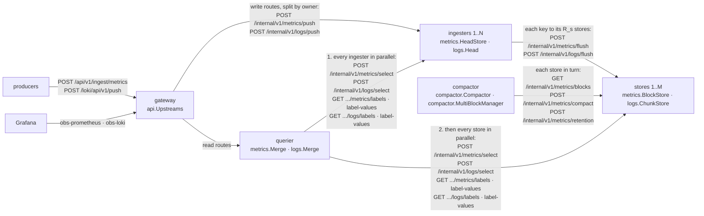
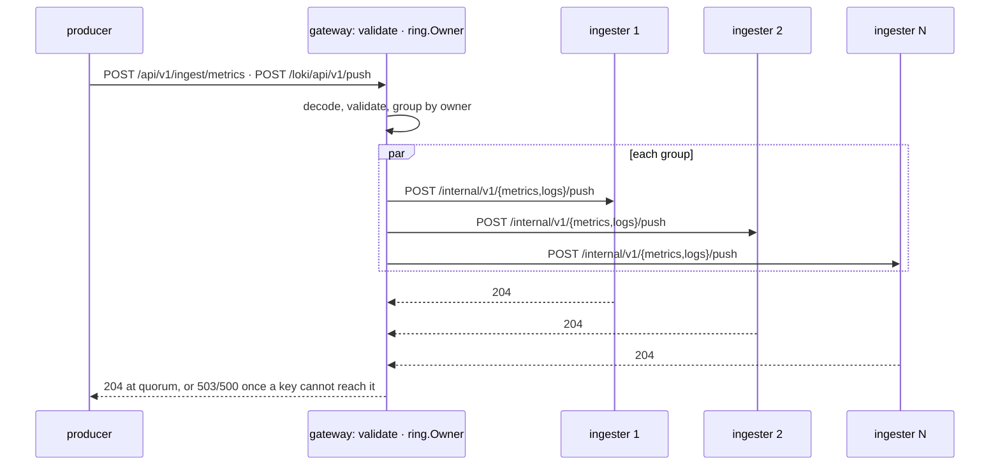
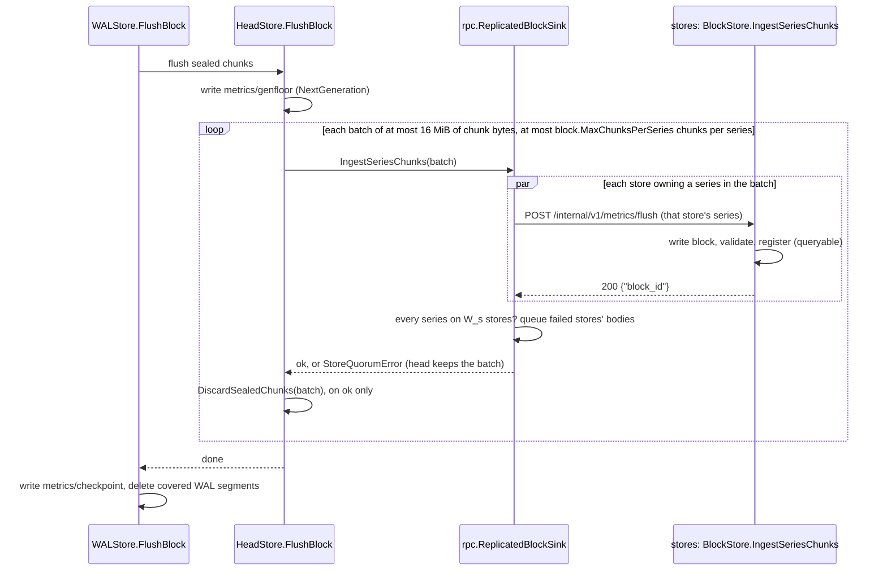
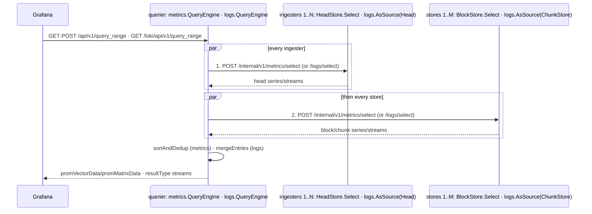

# Components

The backend runs as one process (`OBS_TARGET=all-in-one`, the default) or as
five (`gateway`, `ingester`, `querier`, `store`, `compactor`). It is one binary
either way; the target decides what a process serves, runs, and owns. This page
is the split topology's reference: what each component does, which data it
owns, how data moves between them, and what happens when one is down.

The all-in-one process is the same components assembled in-process — same
routes, same on-disk layout, same single maintenance loop — so everything in
[README.md](README.md) describes it unchanged.

## Responsibilities and ownership

| Target | Serves | Background work | Owns on disk | Calls |
|---|---|---|---|---|
| `all-in-one` | every public route | flush → compact → retain | the whole data directory | — |
| `gateway` | every public route; the two write routes are validated and routed, the read routes proxied | — | — | every ingester, querier |
| `ingester` | the two public write routes, the two internal push routes; internal head reads | metrics flush loop; logs threshold flush; store retry queue | `metrics/wal`, `metrics/checkpoint`, `metrics/genfloor`, `logs/wal` | each key's stores |
| `querier` | the nine read routes | — | — | every ingester, every store |
| `store` | internal only: flush-in, reads, block maintenance, handoff | — | `metrics/blocks`, `metrics/tmp`, `logs/chunks`, `logs/index` (of the keys it holds) | the remaining stores, during a handoff |
| `compactor` | — | compact → retain, each store in turn | — | every store |

Every durable directory has exactly one owning process, so no volume is shared
between components and no process ever reasons about another mutating a
directory under it. Peers are named by `OBS_INGESTER_URL` (a comma-separated
list on the gateway and querier, see [The ring](#the-ring)), `OBS_STORE_URL`
(a list on the ingester, querier, and compactor, see [Stores](#stores-64)),
and `OBS_QUERIER_URL`; a target refuses to start if one it needs is missing or one
it does not use is set. The internal API is described in
[../api/internal.md](../api/internal.md); it carries no authentication,
matching the public API (see [../api/limitations.md](../api/limitations.md)),
and is reachable in Kubernetes only through ClusterIP Services.



## The ring

The gateway and the querier take `OBS_INGESTER_URL` as a comma-separated list;
each URL is a ring member, identified by the URL with any trailing `/` trimmed.
The list is refused if an element is empty or repeats another after that
normalization. One URL is a one-member ring and behaves as the single ingester
did before. `OBS_QUERIER_URL` stays a single URL; `OBS_STORE_URL` is a list
too, for the store ring ([Stores](#stores-64)), which is built the same way.

`internal/ring` is a token ring with no I/O: each member gets 128 tokens on a
64-bit ring, and a key belongs to the member of the first token at or past its
mixed hash, wrapping at the top. The ring is a function of the member *set*, so
list order does not matter. The key is the series fingerprint for metrics
(over the full label set including `__name__`, routed per sample) and the
stream fingerprint for logs (routed per stream, so one stream's entries in a
push go to one ingester). Adding or removing a member moves only the keys that
member gains or loses.

At startup the gateway and the querier each log `ring ready` with
`members=N ring=<8 hex chars>`, the hash of the sorted member list. Equal
hashes mean the same member set; compare them whenever writes seem to
disappear.

### Write path

The gateway no longer proxies the two write routes. It decodes and validates
the body with the same code all-in-one and an ingester's public routes run, so
every topology refuses the same input with the same `400` body and counts it in
`obs_samples_rejected_total` or `obs_log_lines_rejected_total`. It then groups
samples and streams by owner (by its RF replicas when
[replication](#replication-63) is on; the table below is the RF=1 rule) and
sends each group to its ingester concurrently over `POST
/internal/v1/metrics/push` or `/logs/push`
([../api/internal.md](../api/internal.md)), each carrying the inbound
`X-Request-Id`. It answers `204` once every key has its quorum of
acknowledgements, and otherwise the moment some key can no longer reach it,
without waiting for groups still running:

| Outcome | Status |
|---|---|
| every group answered `204` | `204` |
| a transport error, a deadline, or a `5xx` | `503` `{"error":"write quorum not met: <k> of <n> series could not reach 1 of 1 ingesters"}` (`streams` on the Loki route) |
| a `4xx` from an ingester | `500` `{"error":"internal error"}`, logged at ERROR with the cause and the failing ingesters: the gateway validated the body, so the two disagree about the protocol |
| the client went away | `499`; sends already started run on, detached from the request, each bounded by `OBS_INGESTER_TIMEOUT` |

The failures seen when the answer is decided set the code: a protocol error
among them makes it `500`, else `503`. A group that fails later, after the
answer, is still counted (`obs_gateway_ingester_requests_total`, and the
batch's `obs_gateway_write_quorum_total` outcome) but not logged, and does not
change the answer, so when one group gets an outage and another a protocol
error, which arrives first decides between `503` and `500`
([../api/limitations.md](../api/limitations.md)). A `503` can leave some
groups written. Retrying the whole batch is safe: a metrics retry
rewrites the same values at the same timestamps, and reads already collapse
duplicate log entries by `(timestamp, line)`.



An ingester validates a push again and answers `400` for a malformed body or
`500` if the append fails. It counts only an append failure as a rejection
(reason `append`), because the gateway already counted the validation
rejections. It does not check that it owns the keys it is
sent: a write sent to the wrong ingester is still read, because every read
covers every member.

### Replication (6.3)

`OBS_REPLICATION_FACTOR` (RF, default 1) on the gateway and querier makes every
series and stream live on RF ingesters. `ring.Replicas(key, RF)` is the next RF
distinct members clockwise from the key, and its first member is the owner, so
RF=1 places as before. Both processes refuse an RF above their ingester list,
and the two values must match: their `ring ready` lines carry
`replication_factor` and `quorum` beside the ring hash.

- **Quorum.** W = RF/2 + 1 per key. The gateway sends each member one push with
  every key it replicates, all concurrently, and answers `204` the moment every
  key has W acknowledgements. The rest finish in the background, still counted.
- **Failure.** The moment a key can no longer reach W, the gateway answers
  `503` for an outage, or `500` if a protocol error is among the failures seen
  so far; it does not wait for replicas still running. The `503` body is
  `write quorum not met: <k> of <n> series could not reach <W> of <RF>
  ingesters` (streams on the Loki route). At RF=3 one ingester down changes
  nothing a client sees; two down is `503`.
- **Reads.** The querier skips up to W-1 ingesters that fail with an outage; a
  protocol error, one more outage, or every ingester skipped fails the read.
  Every acknowledged write is on at least W replicas, so at least one replica
  is still read. Copies differ only in generation and collapse on read; each
  store holds RF copies of a flushed log chunk, and metrics compaction merges
  the copies within a store.
- **Deadlines.** `OBS_INGESTER_TIMEOUT` (default 10s, at least 100ms) bounds
  each push and each ingester read; a timeout is an outage, so a hung ingester
  is a failed replica.
- **Member identity.** Every internal request names the member it meant
  (`X-Obs-Member`), and an ingester given `OBS_INGESTER_SELF_URL` refuses one
  meant for another with `421`, an outage to the caller. A connection that
  reaches the wrong ingester -- an address reused across a container restart,
  held by keep-alive -- then never counts one ingester's acknowledgement twice.
- **Metrics.** `obs_gateway_write_quorum_total{outcome}` (`full`, `degraded`,
  `failed`) and `obs_querier_ingester_reads_total{ingester,outcome}`; the
  internals dashboard plots them as "Write quorum" and "Ingester reads".

### Read path

See [Reads](#reads-and-why-a-flush-is-invisible-to-them): the querier reads
every ingester in parallel, then every store in parallel, skipping up to W-1
failed ingesters and W_s-1 failed stores.

### Membership changes

Membership is static; a change takes a restart of the gateway and the querier,
staged so the gateway never writes to an ingester the querier does not read (a
read would answer `200` with those writes missing):

- **Adding an ingester:** start it, restart the **querier** with the longer
  list, then the **gateway**. About 1/N of series and streams route to the new
  member from then on. Their older data stays on the previous owner until that
  ingester flushes it; every read covers both, and generations order any
  overlap.
- **Removing an ingester:** restart the **gateway** without it, drain it
  (`POST /internal/v1/drain` first stops the ingester taking writes, then
  answers `200` only once its whole head — every metrics chunk, open ones
  included, and every buffered log line — is on a quorum of its stores, so the `200` covers
  every write it acknowledged), stop it, then restart the **querier** without
  it. Reads answer `503` while a stopped ingester is still on the querier's
  list. A graceful stop runs the same drain within the process's shutdown
  budget, but only the route's `200` is an acknowledgment; what a failed drain
  leaves stays in that ingester's WAL
  ([../api/limitations.md](../api/limitations.md)).
- Once a change is complete the two lists match. Helm renders both from one
  helper (`backend.ingesterURLs`) and stages the change with
  `split.ingester.writeReplicas`, which keeps the gateway's list a prefix of
  the querier's, and on an upgrade it reads the ingester counts the running
  gateway and querier pods loaded (a pod-template annotation) and refuses an
  unstaged change, or any ring change while either Deployment is still rolling
  out; in Compose the two literal lists are edited by hand in the
  order above, and the `ring` hash in the two `ring ready` startup lines
  confirms they match at the end.

### Generations

Last-write-wins between two samples at one timestamp is decided by write
generation, `gen = max(previous + 1, now in Unix µs)`. A write routed by the
gateway carries the generation the gateway stamped when it admitted it, and
every replica stores exactly that one, so replicas agree on which of two
writes is newer however late a push lands; a write sent straight to an
ingester, and every write in all-in-one, gets one from the process that
stores it. An ingester's own counter is strictly increasing
(the persisted `genfloor` keeps it so across a restart, even if the clock steps
back) and comparable across ingesters up to their clock skew, so a write
accepted later on any ingester outranks an earlier one. Counter-era
generations are small, so new writes outrank them without a migration.

The generation is assigned before the WAL write and recorded in WAL record
type `0x02` (the type-1 body plus 8 bytes of generation). Replay restores it
exactly and raises the floor past it, so an ingester replaying an old write
cannot outrank a newer write another ingester took. A type-1 record, written
before the ring, replays with a fresh generation as it always did.

The cost is chunk size: per-sample generations are stored as varint deltas, and
a µs delta is larger than a counter's. Measured for a 120-sample chunk at a
15 s interval: 4.64 bytes per sample with the old counter and 5.63 with µs
generations, 0.99 more.

## Stores (6.4)

Flushed data is sharded over several stores and replicated to R_s of them, so
one store down fails neither flushes nor reads, and stores can be added and
removed without losing data.

- **Store ring.** `OBS_STORE_URL` is a list on the ingester, querier, and
  compactor, parsed like `OBS_INGESTER_URL`, and `internal/ring` builds a
  second ring from it. A key's stores are `Replicas(hash, R_s)` with
  `OBS_STORE_REPLICATION_FACTOR` (R_s, default 1, at most the store count; on
  the ingester and querier only), over the same key the ingester ring uses
  (`Labels.Hash()` for metrics, `StreamLabels.Hash()` for logs). Every
  ingester replica of a series therefore sends its copy to the same stores,
  and compaction there still merges the copies. The ingester logs `store ring
  ready` with `stores` and `store_replication_factor` at startup.
- **Flush quorum.** `rpc.ReplicatedBlockSink` and `rpc.ReplicatedChunkSink`
  sit behind the heads' existing sink seams. For one batch they group the
  series (streams) by store, send every store its group concurrently, and wait
  for all of them; the batch succeeds only if every key has W_s = R_s/2 + 1
  acknowledgements. Otherwise they return a `StoreQuorumError` (an outage only
  when every failure was one) and the head keeps the whole batch, exactly as a
  failed single-store flush did. A re-flush puts a second copy on the stores
  that had acknowledged; reads collapse it, and for metrics compaction removes it
  (log copies stay on disk). Outcomes are
  counted in `obs_ingester_store_flush_total{outcome}`: `full`, `degraded`
  (quorum met, some store failed), or `failed`.
- **Stragglers.** A degraded batch's failed groups go to `rpc.StragglerQueue`,
  which resends each body unchanged to its store on the ingester's maintenance
  loop, oldest first, with a per-item backoff from 1 s doubling to 1 m. It is
  bounded by `OBS_STORE_RETRY_MAX_BYTES` (64 MiB) and `OBS_STORE_RETRY_MAX_AGE`
  (15 m), dropping the oldest past either, and is in memory only
  ([../api/limitations.md](../api/limitations.md)).
- **Reads.** The querier reads every store in parallel and skips up to
  W_s − 1 that fail with an outage. Every acknowledged flush is on at least W_s
  of a key's R_s stores, so with at most W_s − 1 skipped, one store holding
  each key is still read. Store reads are bounded by `OBS_INGESTER_TIMEOUT`,
  like ingester reads, and counted in
  `obs_querier_store_reads_total{store,outcome}`; a read that skipped a store
  names it in its `read answered by replication` line.
- **Member identity.** A store given `OBS_STORE_SELF_URL` refuses, with `421`,
  a request whose `X-Obs-Member` names another store, as an ingester does, so
  a reused address cannot land a key's copy on a store that does not own it.
- **Adding a store** is staged: the querier and compactor list it before any
  ingester flushes to it. Keys whose replica set changes keep their older
  blocks on their previous stores; reads cover every store, and those copies
  stay until retention.
- **Removing a store** is staged the other way: the ingesters drop it, then
  `POST /internal/v1/handoff` on the leaving store closes its flush barrier and
  copies every series and stream it holds to every owner on the remaining
  ring, answering `200` only when all of them acknowledged every batch
  ([../api/internal.md](../api/internal.md#handoff-store-only)); only then do
  the querier and compactor drop it. Every key on the leaving store had at
  least W_s copies on its old replica set; the handoff gives every owner on
  the new ring a copy, so reads that skip W_s − 1 stores afterwards still find
  one. One store leaves per handoff.

The procedures are in
[../runbooks/split-demo.md](../runbooks/split-demo.md#add-or-remove-a-store).

## The flush



The generation floor is written first because last-write-wins between two
samples at one timestamp is decided by write generation, and the blocks that
would otherwise seed the ingester's counter live in another process. With the
floor persisted before anything is sent, no block the ingester ever ships can
outrank a write it accepts after a restart.

A batch also never carries more than `block.MaxChunksPerSeries` chunks for any
one series, split across batches if a series' backlog is larger: `store`'s
block reader (`block.OpenReader`) refuses a block whose index declares more
chunks than that for a series, and it only discovers that after the store has
already written and fsynced it. The store then deletes that rejected block and
answers with an error (`BlockStore.ingestLocked`'s `OpenReader` branch), so no
data is lost — the ingester keeps its chunks and retries — but without the cap
every retry of an over-limit series would fail the same way and that series'
flush would wedge for good. The ingester enforces the cap before sending so
that failure mode never happens.

`BlockStore.IngestSeriesChunks` refuses malformed input — zero series, a
duplicate series ID, a series with no chunks, an empty chunk, or a label set
that does not fingerprint to its claimed ID — with `ErrInvalidSeriesChunks`,
which the store's flush-in handler answers as `400`; any other failure is
`500`.

The logs head (`Head.flushLocked`) flushes similarly — batched requests to the
same sink seam — but differs in three ways:

- it holds its lock from snapshot to reset and drops nothing from memory until
  *every* batch in the flush has been acknowledged, not batch-by-batch like the
  metrics head: `LogWAL.Checkpoint` deletes every segment, so the checkpoint
  (and the head reset) is only correct once the whole flush has landed;
- a failure part-way through therefore leaves the whole head intact, so the
  next attempt resends batches the store already holds — those duplicates are
  absorbed by the `(timestamp, line)` dedup a read applies, the same dedup
  that already covers the crash window between a chunk write and its
  checkpoint;
- it has no generation floor: logs entries never need one, since ordering
  between head and persisted entries is fixed (persisted ahead of head at an
  equal timestamp) rather than resolved by a write generation.

Its batches are sized by estimated wire bytes — the JSON an `IngestStreams`
call would encode, not raw log-line bytes — so a batch of highly-escaped lines
still lands under the store's body limit. In the ingester a failed logs flush
does not fail the push that triggered it — the entry is already in the WAL —
and flushes pause for 30 s.

## Reads, and why a flush is invisible to them

The querier reads through
`Merge(MergeHeadsWith(ingesterOpts, ingesters...), MergeHeadsWith(storeOpts, stores...))`
for each signal. `metrics.MergeHeadsWith` and `logs.MergeHeadsWith` read every
member of one layer concurrently, keep each answer at its member's index, and
once every needed answer is in, fold them with `Merge` in member order — the
fold a sequential read would do — so the answer does not depend on which
member replies first (`TestMergeHeadsWithAnswerIgnoresArrivalOrder`). A layer
is decided as soon as its outcome is certain: a non-skippable error, or one
outage more than it tolerates, fails it at once, and the reads still running
are cancelled; a read cancelled that way is not counted as an outage
(`TestMergeHeadsWithStopsEarlyAndDoesNotObserveCancelled`). Answers already in
when the layer is decided are taken and observed too, so a protocol error that
is in wins over the outage that decided it
(`TestGatherPrefersAQueuedProtocolErrorOverAnOutage`). If every member was
skipped, the last outage is returned rather than an empty answer.

`Merge` reads its first argument to completion before it starts the second, so
the two layers never overlap: every ingester read finishes before any store
read starts (`TestMergeHeadsFinishesEveryHeadBeforeTheStore`). That order is
the whole no-gap argument, and the reason the ingesters come first:

1. a store registers a flushed block before it acknowledges the flush;
2. an ingester discards those chunks only after a quorum of its stores
   acknowledged;
3. the querier finishes reading every ingester before it starts on the stores.

Read the stores first and a flush landing between the two layers would be in
neither answer. Reads within a layer may run in parallel, which is why read
latency is the slowest ingester plus the slowest store, not the sum
(`TestMergeHeadsWithReadsHeadsInParallel` in `internal/metrics` and `internal/logs` for
the layer-generic parallelism; `TestStoreClusterReadsIngestersInParallel` for the
ingesters). No member is pruned by selector:
a series is placed by the hash of its full label set, and no selector proves
it names one ([../api/limitations.md](../api/limitations.md)).



A sample missing from every ingester's answer was therefore discarded before
that read began, so a quorum of its stores had it before the store reads
began, and with at most W_s − 1 stores skipped one of them is read. Overlap between the
answers is resolved per signal, by the same rule the equivalent all-in-one path
already applies between its own head and persisted data — one rule per signal,
not two, shared by all-in-one and split:

- metric samples merge by `(timestamp, highest generation)` through
  `sortAndDedup` — the function `metrics.Merge` calls and `BlockStore` itself
  uses between its head and its blocks;
- log entries dedup by `(timestamp, line)`, persisted ahead of head at an equal
  timestamp, through `mergeEntries` — the function `logs.Merge` calls and the
  one `logs.Store.StreamEntries` uses between its head and its chunk store in
  all-in-one.

## Compaction

The compactor maintains every store in its `OBS_STORE_URL`, one after another:
`compactor.MultiBlockManager` compacts each store to stable (repeating its
compaction until nothing is left to merge), then applies retention to each. A
store that fails is logged, counted in
`obs_compactor_store_passes_total{store,outcome}` (one per store per
compaction or retention call), and skipped; the others are still maintained
(`TestRunOnceCompactsHealthyStoreToStableWhileAnotherFails`). Compaction never
crosses stores: each store merges the blocks it holds, including the ingester
replicas' copies of its keys. It never crosses tenants either: the planner
groups blocks by tenant before it groups by time. The retention pass sends each
store the default window and the per-tenant overrides, for blocks and then for
log chunks (`compactor.MultiLogManager`, which skips and counts a failing store
the way blocks do).

The compactor owns the policy — planning with `compactor.Plan`, the cadence,
the retention clock, and the maintenance metrics. The store owns the mechanism:
`rpc.BlockManager.CompactOnce` lists the store's blocks, plans locally, and
posts the chosen groups; the store re-checks that each group's blocks still
exist and runs `BlockStore.CompactOnce` with every integrity check it has
always run. That runs under `flushMu` end to end — the same lock
`IngestSeriesChunks` takes, so a flush and a compaction never race on the block
set — and takes the readers' `bs.mu` only briefly, for the swap that installs
the merged block and retires its sources; every read against `bs.mu` sees
either the pre-compaction or the post-compaction set, never a partial one.

```mermaid
sequenceDiagram
  participant C as compactor.Compactor
  participant B as rpc.BlockManager
  participant S as store: BlockStore.CompactOnce
  C->>B: CompactOnce(compactor.Plan)
  B->>S: GET /internal/v1/metrics/blocks
  S-->>B: block list
  B->>B: compactor.Plan(blocks)
  B->>S: POST /internal/v1/metrics/compact {groups}
  S->>S: re-check each group's blocks still exist
  S->>S: BlockStore.CompactOnce (flushMu end to end; bs.mu only for the swap)
  S-->>B: 200 {"compacted": n}
  C->>B: ApplyRetention(now, retention)
  B->>S: POST /internal/v1/metrics/retention
  S-->>B: 200 {"deleted": n}
```

## When a component is down

| Down | Writes | Reads and metadata | Background work |
|---|---|---|---|
| one store (of 4, R_s 3) | accepted | complete: the querier skips it | flushes meet quorum (`degraded`) and queue its copies for retry; its compaction is skipped |
| two stores (of 4, R_s 3) | accepted: WAL + head; the heads grow | `503` `unavailable` | a flush batch with a key on both fails, is counted, and retries; the head keeps it |
| one ingester (RF 1) | `503` at the gateway for any batch with a key it owns; other batches succeed | `503` at the querier | — |
| querier | unaffected | `503` at the gateway | — |
| compactor | unaffected | unaffected | no compaction or retention until it returns |

Reads fail closed: a query never answers from some sources while another is
down beyond what replication covers, because a partial answer would look
complete. The ingester rows for RF above 1 are in
[Replication](#replication-63); with stores, the table above is the Compose
and Helm default. Readiness reports only a
process's own state — its data directory, for the ingester and store — so one
component's outage never marks its dependents unready.

A peer outage or a deadline (`rpc.ErrUnavailable`, including a wrapped
`context.DeadlineExceeded`) answers `503`; a caller that leaves before a query
finishes answers `499` `canceled` instead — Grafana abandoning a dashboard
refresh or zoom is not a server error, and counting it as one would inflate the
self-observability dashboard's error rate for something that never failed. The
gateway applies the same rule to a client that disconnects mid-proxy: `499`,
not `503`.

## Tenants

A tenant is `X-Scope-OrgID` on the wire and a reserved `__tenant__=<id>` label in
a series' or stream's identity; the default tenant, `anonymous`, carries no
label, so everything written before tenancy is the default tenant's and needs no
migration. The same decisions hold in all-in-one and split; this is where each
layer takes part (`internal/tenant` owns the ID rules, the middleware and the
overrides).

| Layer | What it does for a tenant |
|---|---|
| Public routes (all-in-one, gateway, querier) | The tenant middleware validates the header (`400`), applies `OBS_TENANT_REQUIRED` (`401`), and puts the tenant in the request context. Each route family answers in its own error shape |
| Write path | After validation the API adds the label (`labels.WithTenant`; clients cannot send `__tenant__`), caps the body at the tenant's push limit (`413`), and admits the push through `limits.Gate` (`429`). Because the label is part of the label set, it is part of the fingerprint, the WAL record, the block and chunk file, ring and store placement, the retry queue and the handoff, with no format change |
| Internal RPC | `rpc.Client` sets the header from the context on every request; the ingester's and store's read and push routes refuse a request without it (`400 missing tenant`) |
| Reads | Every local source is wrapped where it is served (`metrics.TenantSource`, `logs.TenantSource`): the all-in-one engines, the ingester's internal read routes, the store's. A named tenant gets the matcher `__tenant__=t`; the default tenant drops every series that carries the label; the label is stripped from every answer. Label names and values are computed from the tenant's own series. The gateway proxies reads to the querier unchanged, which applies the same middleware. The query engine and the merge never see `__tenant__`, and a sample's `SeriesID` is the full hash, so equal-looking series of two tenants never merge |
| Admission | `limits.Gate` holds a per-tenant mutex across counting and appending, so the active series and stream limits are exact under concurrent pushes; a tenant with no limit takes no lock. An ingester enforces its share, ⌈limit × RF ÷ N⌉. The count is the head's, kept by `MemoryStore.TenantSeries` and `logs.Head.TenantStreams` |
| Split write quorum | An ingester answers `429`, `rpc.Client` maps it to `rpc.ErrLimited`, and the router ranks a failed batch's cause protocol error > limited > unavailable > canceled; a key refused by more than RF − W replicas fails the batch and the gateway answers `429` |
| Blocks | `BlockStore` writes one block per tenant when a batch spans tenants (`meta.json` `tenant`, omitted for the default); the planner groups by tenant, so compaction never merges two tenants |
| Retention | `tenant.RetentionPolicy` (default plus per-tenant overrides) reaches the compactor and stores: a block is deleted when its `MaxTime` is older than its tenant's window; logs gain `ChunkStore.ApplyRetention`, deleting chunk files whose newest entry is older than their stream's tenant window, driven in split mode by `POST /internal/v1/logs/retention` on each store |

Reads of a tenant that exists nowhere simply return nothing: there is no tenant
registry, so a tenant exists as soon as it writes. Limits and retention come
from environment defaults and an optional overrides file read at startup
(`OBS_TENANT_OVERRIDES_FILE`; the querier and the store refuse it, since neither
admits writes nor decides retention).
What tenancy does not provide is in
[../api/limitations.md](../api/limitations.md#tenancy).

## Observability

Each component exports only the metrics for work it does. The gateway and the
querier export `obs_ring_members`, the size of the ring they route over or
read. The gateway also exports `obs_gateway_ingester_requests_total{ingester,
outcome}`, the write groups it sent to each ingester (`ingester` is the
member's host:port; `outcome` is `ok`, `unavailable`, or `error`), `obs_gateway_write_quorum_total{outcome}`
(see [Replication](#replication-63)), and, since
validation now runs there, the ingest rejection counters. Each ingester counts
the samples and lines it ingested, which shows how evenly the ring spreads
writes. The ingesters (and all-in-one) export
`obs_tenant_active_series{tenant}` and `obs_tenant_active_streams{tenant}`, from
the heads' per-tenant counts, and the component that decides a refusal exports
`obs_tenant_limit_rejections_total{tenant,limit}` (`series`, `streams`,
`push_bytes`); the access log line carries `tenant`. The compactor counts
`obs_logs_retention_deleted_chunks_total`. The querier exports `obs_querier_ingester_reads_total{ingester,outcome}`
and `obs_querier_store_reads_total{store,outcome}`. Each ingester exports
`obs_ingester_store_flush_total{outcome}`, `obs_ingester_store_retries_total{outcome}`
(`ok`, `failed`, `dropped`), and `obs_ingester_store_retry_pending_bytes`; the
compactor exports `obs_compactor_store_passes_total{store,outcome}`. The
internals dashboard plots them as "Store flush quorum", "Store reads", and
"Store retry queue". Every scrape target
carries a `component` label; the internals dashboard counts HTTP only at the
edge (`all-in-one` or `gateway`) and plots `up` by component. Every log line
carries `target=<mode>`, and one `X-Request-Id` follows a request from the
gateway through the querier to the ingester and store.

## Deploying it

- Compose: [../runbooks/split-demo.md](../runbooks/split-demo.md), from
  `deployments/docker/docker-compose.split.yml`, with three ingesters
  (`ingester-1` to `ingester-3`) and four stores (`store-1` to `store-4`) at
  store replication factor 3. The ingesters and stores get a
  60 s `stop_grace_period` there, long enough for a graceful stop to finish an
  in-flight flush instead of being killed mid-write.
- Kubernetes: the backend chart's `topology: split`; see
  [../../deployments/helm/README.md](../../deployments/helm/README.md), with
  `split.ingester.replicas` ingesters (default 3) and `split.store.replicas`
  stores (default 4) at `split.storeReplicationFactor` (default 3). The
  ingester and store StatefulSets set `terminationGracePeriodSeconds: 60` for
  the same reason.
